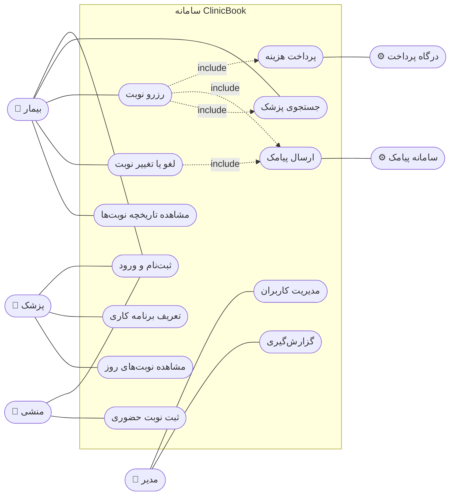
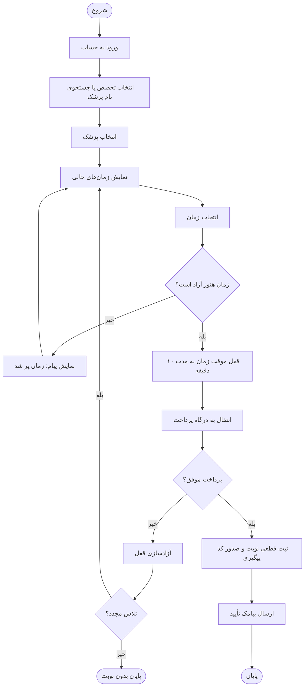
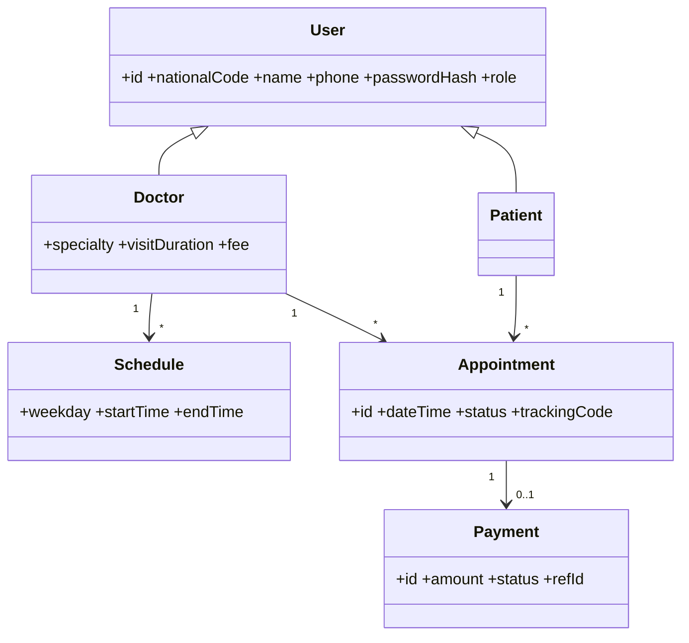
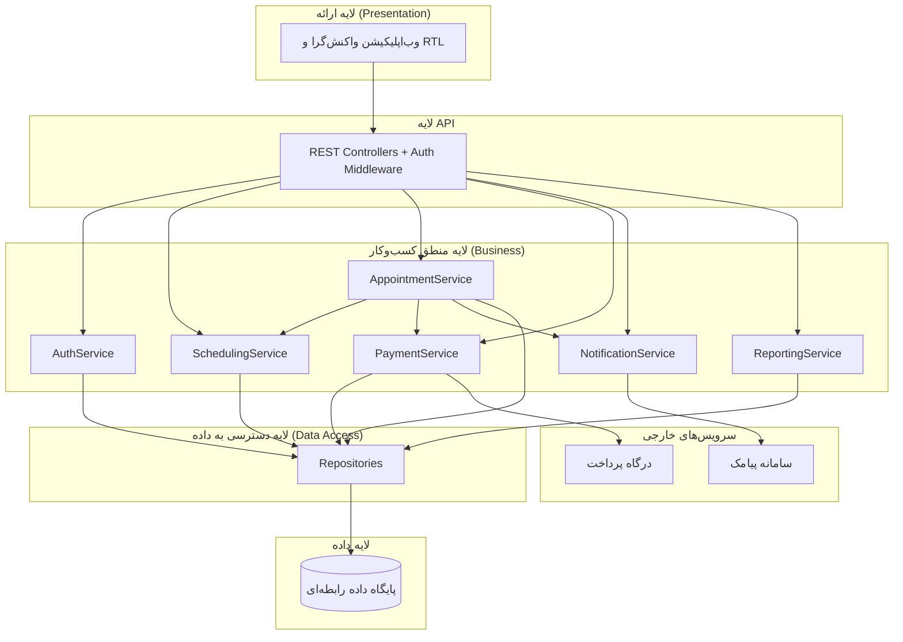
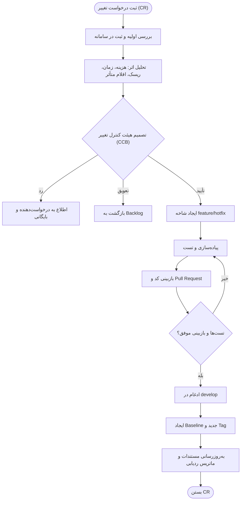
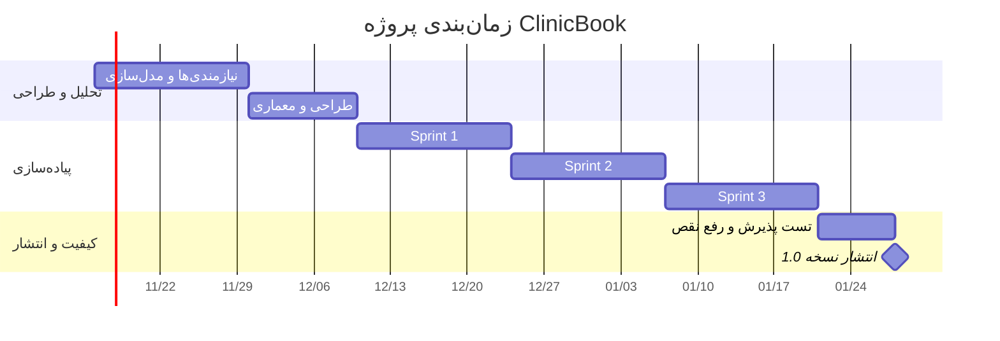

# دفترچه‌ی مستندات تحلیلی پروژه
## سامانه رزرو نوبت درمانگاه (ClinicBook)

**درس:** مهندسی نرم‌افزار
**نام دانشجو:** ____________  |  **شماره دانشجویی:** ____________
**استاد:** ____________

---

## خلاصه‌ی مدیریتی
ClinicBook سامانه‌ای تحت وب برای رزرو، پرداخت و مدیریت نوبت‌های درمانگاه است. این دفترچه چرخه‌ی کامل تحلیل و طراحی را بر اساس فصل‌های درس پوشش می‌دهد: از داستان‌های کاربر و نیازمندی‌ها، مدل‌سازی UML، طراحی ماژولار و معماری لایه‌ای، تا تضمین کیفیت، تست، مدیریت پیکربندی، مدیریت ریسک و تخمین و زمان‌بندی. چالش فنی اصلی پروژه جلوگیری از رزرو هم‌زمان یک زمان است که در معماری، تست و ریسک‌ها به‌طور مشخص پیگیری شده است.

## فهرست
1. داستان‌های کاربر و Product Backlog
2. نیازمندی‌ها
3. مدل‌سازی UML
4. ماژول‌ها، Cohesion و Coupling
5. معماری و اینترفیس‌ها
6. تضمین کیفیت
7. تست
8. مدیریت پیکربندی
9. مدیریت ریسک
10. تخمین، زمان‌بندی و نگهداری
11. جمع‌بندی


---

## هفته ۱ — داستان‌های کاربر و Product Backlog

**پروژه:** سامانه رزرو نوبت درمانگاه (ClinicBook)
**موضوع جلسه:** توسعه چابک و اسکرام (فصل ۳ پرسمن)

## ۱. معرفی کوتاه سیستم
ClinicBook یک سامانه‌ی تحت وب است که به بیماران اجازه می‌دهد پزشک را جستجو کنند، نوبت رزرو و پرداخت کنند و در صورت نیاز لغو کنند. پزشکان برنامه‌ی کاری خود را مدیریت می‌کنند، منشی نوبت‌های حضوری را ثبت می‌کند و مدیر درمانگاه گزارش می‌گیرد.

## ۲. نقش‌های اسکرام
| نقش | مسئول |
|---|---|
| Product Owner | مدیر درمانگاه (نماینده‌ی ذینفعان) |
| Scrum Master | هماهنگ‌کننده‌ی فرایند تیم |
| Development Team | تیم توسعه (در این پروژه‌ی انفرادی، یک نفر چند نقش را بر عهده می‌گیرد) |

## ۳. داستان‌های کاربر اصلی (۵ داستان)
قالب: «به‌عنوان <نقش>، می‌خواهم <هدف>، تا <دلیل>»

### US-01 ثبت‌نام و ورود بیمار
**به‌عنوان** بیمار، **می‌خواهم** با کد ملی و شماره موبایل ثبت‌نام کنم و وارد شوم، **تا** سوابق و نوبت‌هایم در حساب شخصی من ذخیره شود.
- معیار پذیرش: کد ملی ۱۰ رقمی و معتبر باشد.
- معیار پذیرش: رمز عبور حداقل ۸ کاراکتر باشد.
- معیار پذیرش: پس از ورود موفق، به داشبورد بیمار هدایت شود.

### US-02 جستجوی پزشک
**به‌عنوان** بیمار، **می‌خواهم** پزشکان را بر اساس تخصص و نام جستجو کنم، **تا** سریع پزشک مناسب را پیدا کنم.
- معیار پذیرش: نتایج با فیلتر تخصص محدود شوند.
- معیار پذیرش: برای هر پزشک نزدیک‌ترین زمان آزاد نمایش داده شود.

### US-03 رزرو نوبت
**به‌عنوان** بیمار، **می‌خواهم** یک زمان خالی از برنامه‌ی پزشک انتخاب و رزرو کنم، **تا** بدون مراجعه‌ی حضوری نوبت بگیرم.
- معیار پذیرش: فقط زمان‌های آزاد قابل انتخاب باشند.
- معیار پذیرش: یک زمان هرگز برای دو بیمار رزرو نشود.
- معیار پذیرش: پس از رزرو، کد پیگیری نمایش داده شود.

### US-04 لغو یا تغییر نوبت
**به‌عنوان** بیمار، **می‌خواهم** نوبتم را لغو یا جابه‌جا کنم، **تا** در صورت بروز مشکل، زمان آزاد شده به دیگران برسد.
- معیار پذیرش: لغو فقط تا ۲ ساعت قبل از نوبت ممکن باشد.
- معیار پذیرش: پس از لغو، زمان دوباره آزاد شود.

### US-05 تعریف برنامه کاری پزشک
**به‌عنوان** پزشک، **می‌خواهم** روزها و ساعت‌های حضور و مدت هر ویزیت را تعریف کنم، **تا** بیماران فقط در زمان‌های واقعی نوبت بگیرند.
- معیار پذیرش: برنامه‌ی هفتگی قابل ثبت و ویرایش باشد.
- معیار پذیرش: تغییر برنامه روی نوبت‌های قبلاً رزروشده اثر مخرب نگذارد و به بیماران اطلاع داده شود.

## ۴. Product Backlog (اولویت‌بندی‌شده)
| شناسه | داستان | اولویت | امتیاز (Story Point) |
|---|---|---|---|
| US-01 | ثبت‌نام و ورود بیمار | بالا | ۳ |
| US-10 | مدیریت کاربران توسط مدیر | بالا | ۳ |
| US-05 | تعریف برنامه کاری پزشک | بالا | ۵ |
| US-02 | جستجوی پزشک | بالا | ۳ |
| US-03 | رزرو نوبت | بالا | ۸ |
| US-04 | لغو یا تغییر نوبت | متوسط | ۵ |
| US-07 | پیامک یادآوری نوبت | متوسط | ۳ |
| US-06 | پرداخت آنلاین هزینه ویزیت | متوسط | ۸ |
| US-08 | ثبت نوبت حضوری توسط منشی | متوسط | ۵ |
| US-09 | گزارش‌گیری برای مدیر | پایین | ۵ |

**داستان‌های تکمیلی:**
- **US-06** به‌عنوان بیمار می‌خواهم هزینه‌ی ویزیت را آنلاین بپردازم تا نوبت قطعی شود.
- **US-07** به‌عنوان بیمار می‌خواهم ۲۴ ساعت قبل از نوبت پیامک یادآوری دریافت کنم تا نوبتم را فراموش نکنم.
- **US-08** به‌عنوان منشی می‌خواهم نوبت حضوری را در سیستم ثبت کنم تا تداخلی با نوبت‌های آنلاین ایجاد نشود.
- **US-09** به‌عنوان مدیر می‌خواهم گزارش تعداد نوبت‌ها و درآمد را ببینم تا عملکرد درمانگاه را ارزیابی کنم.
- **US-10** به‌عنوان مدیر می‌خواهم حساب پزشکان و منشی‌ها را بسازم و غیرفعال کنم تا دسترسی‌ها کنترل شود.

## ۵. تعریف «انجام‌شده» (Definition of Done)
یک داستان وقتی کامل است که: کد بازبینی شده، تست‌های واحد و پذیرش آن موفق، مستندات به‌روز و روی شاخه‌ی develop ادغام شده باشد.


---

## هفته ۲ — مهندسی و استخراج نیازمندی‌ها

**موضوع جلسه:** فصل ۷ پرسمن

## ۱. ذینفعان (Stakeholders)
| ذینفع | نوع | علاقه و انتظار اصلی |
|---|---|---|
| بیمار | کاربر نهایی | رزرو سریع، ساده و مطمئن نوبت |
| پزشک | کاربر نهایی | مدیریت برنامه کاری و کاهش نوبت‌های بی‌دلیل |
| منشی | کاربر نهایی | ثبت سریع نوبت حضوری بدون تداخل |
| مدیر درمانگاه | مشتری / Product Owner | گزارش‌ها، کنترل کاربران، افزایش بهره‌وری |
| تیم فنی (IT) | پشتیبان | نصب آسان، لاگ‌گیری، نگهداری‌پذیری |
| درگاه پرداخت | سیستم خارجی | رعایت پروتکل تراکنش |
| سامانه پیامک | سیستم خارجی | ارسال پیام در فرمت تعریف‌شده |
| ناظر قانونی | ذینفع نظارتی | حفظ محرمانگی اطلاعات بیماران |

## ۲. روش‌های استخراج نیازمندی
- **مصاحبه** با مدیر، پزشک و منشی درباره‌ی فرایند فعلی نوبت‌دهی (تلفنی/حضوری).
- **پرسشنامه** از بیماران برای ارزیابی مشکلات نوبت‌گیری فعلی.
- **مشاهده** فرایند کار منشی در ساعات شلوغ.
- **تحلیل مستندات** مانند دفتر نوبت و فرم‌های موجود.
- **نمونه‌سازی** اولیه‌ی صفحات برای دریافت بازخورد.

## ۳. نیازمندی‌های عملکردی (Functional)
| شناسه | نیازمندی |
|---|---|
| FR-01 | سیستم باید ثبت‌نام بیمار با کد ملی، نام، موبایل و رمز عبور را پشتیبانی کند. |
| FR-02 | سیستم باید ورود و خروج کاربران با نقش‌های بیمار، پزشک، منشی و مدیر را فراهم کند. |
| FR-03 | سیستم باید بازیابی رمز عبور از طریق کد پیامکی را ارائه دهد. |
| FR-04 | سیستم باید جستجوی پزشک بر اساس نام و تخصص را امکان‌پذیر کند. |
| FR-05 | پزشک باید بتواند برنامه‌ی هفتگی و مدت هر ویزیت را تعریف و ویرایش کند. |
| FR-06 | سیستم باید زمان‌های خالی هر پزشک را برای تاریخ‌های آینده نمایش دهد. |
| FR-07 | بیمار باید بتواند یک زمان خالی را رزرو کند. |
| FR-08 | سیستم باید از رزرو هم‌زمان یک زمان برای دو بیمار جلوگیری کند. |
| FR-09 | سیستم باید رزرو را پس از پرداخت موفق قطعی کند. |
| FR-10 | بیمار باید بتواند نوبت خود را تا ۲ ساعت قبل از زمان نوبت لغو یا جابه‌جا کند. |
| FR-11 | سیستم باید پس از ثبت، لغو یا تغییر نوبت، پیامک اطلاع‌رسانی ارسال کند. |
| FR-12 | سیستم باید ۲۴ ساعت قبل از نوبت پیامک یادآوری بفرستد. |
| FR-13 | منشی باید بتواند نوبت حضوری ثبت کند. |
| FR-14 | مدیر باید بتواند کاربران را ایجاد، ویرایش و غیرفعال کند. |
| FR-15 | مدیر باید بتواند گزارش تعداد نوبت‌ها و درآمد را در بازه‌ی زمانی دلخواه ببیند. |
| FR-16 | بیمار باید تاریخچه‌ی نوبت‌های خود را مشاهده کند. |

## ۴. نیازمندی‌های غیرعملکردی (Non-Functional)
| شناسه | دسته | نیازمندی (قابل‌اندازه‌گیری) |
|---|---|---|
| NFR-01 | کارایی | ۹۵٪ درخواست‌ها در کمتر از ۲ ثانیه با ۲۰۰ کاربر هم‌زمان پاسخ داده شوند. |
| NFR-02 | دسترس‌پذیری | سیستم حداقل ۹۹٫۵٪ از زمان در دسترس باشد. |
| NFR-03 | امنیت | رمزها با الگوریتم bcrypt ذخیره و ارتباطات فقط با HTTPS انجام شود. |
| NFR-04 | امنیت | کنترل دسترسی مبتنی بر نقش (RBAC) اعمال شود. |
| NFR-05 | حریم خصوصی | اطلاعات هویتی بیماران فقط برای نقش‌های مجاز نمایش داده شود و دسترسی‌ها لاگ شود. |
| NFR-06 | کاربردپذیری | رابط فارسی راست‌به‌چپ و واکنش‌گرا برای موبایل باشد؛ رزرو نوبت حداکثر در ۵ کلیک. |
| NFR-07 | قابلیت اطمینان | هیچ تراکنش پرداختی بدون ثبت نتیجه رها نشود؛ داده‌ها روزانه پشتیبان‌گیری شوند. |
| NFR-08 | نگهداری‌پذیری | معماری ماژولار و پوشش تست واحد حداقل ۷۰٪ باشد. |
| NFR-09 | قابلیت حمل | روی مرورگرهای مدرن (Chrome, Firefox, Edge, Safari) اجرا شود. |

## ۵. محدودیت‌ها و فرضیات
- استفاده از درگاه پرداخت و سرویس پیامک شخص ثالث.
- تقویم نمایشی شمسی و ذخیره‌ی زمان به‌صورت UTC.
- هر بیمار حداکثر ۲ نوبت فعال در روز می‌تواند داشته باشد.


---

## هفته ۳ — مدل‌سازی نیازمندی‌ها (UML)

**موضوع جلسه:** فصل ۸ پرسمن

## ۱. نمودار Use Case



## ۲. شرح Use Case اصلی: رزرو نوبت

| بخش | شرح |
|---|---|
| شناسه | UC-03 |
| بازیگر اصلی | بیمار |
| بازیگران فرعی | درگاه پرداخت، سامانه پیامک |
| پیش‌شرط | بیمار وارد حساب خود شده و پزشک حداقل یک زمان خالی دارد. |
| پس‌شرط (موفق) | نوبت قطعی ثبت، زمان برای دیگران بسته و پیامک تأیید ارسال شده است. |
| پس‌شرط (ناموفق) | زمان انتخاب‌شده آزاد و هیچ نوبتی ثبت نشده است. |

**جریان اصلی:**
1. بیمار پزشک را جستجو و انتخاب می‌کند.
2. سیستم زمان‌های خالی پزشک را نمایش می‌دهد.
3. بیمار یک زمان را انتخاب می‌کند.
4. سیستم زمان را به‌مدت ۱۰ دقیقه برای بیمار قفل موقت می‌کند.
5. سیستم صفحه‌ی پرداخت را نمایش می‌دهد.
6. بیمار پرداخت را انجام می‌دهد.
7. سیستم نوبت را قطعی و کد پیگیری صادر می‌کند.
8. سیستم پیامک تأیید ارسال می‌کند.

**جریان‌های جایگزین:**
- **۳a:** زمان در همین لحظه توسط بیمار دیگری رزرو شده؛ سیستم پیام مناسب نشان می‌دهد و به مرحله‌ی ۲ برمی‌گردد.
- **۶a:** پرداخت ناموفق است؛ سیستم قفل را آزاد می‌کند و امکان تلاش مجدد می‌دهد.
- **۶b:** مهلت ۱۰ دقیقه تمام می‌شود؛ قفل خودکار آزاد و بیمار مطلع می‌شود.
- **۸a:** ارسال پیامک شکست می‌خورد؛ نوبت معتبر می‌ماند و ارسال در صف تلاش مجدد قرار می‌گیرد.

## ۳. Activity Diagram: فرایند رزرو نوبت



## ۴. نمودار کلاس مفهومی (تکمیلی)




---

## هفته ۴ — تفکیک ماژول‌ها، Cohesion و Coupling

**موضوع جلسه:** اصول و مفاهیم پایه طراحی (فصل ۹ پرسمن)

## ۱. تفکیک سیستم به ماژول‌ها
| ماژول | مسئولیت | نیازمندی‌های مرتبط |
|---|---|---|
| Auth (احراز هویت) | ثبت‌نام، ورود، بازیابی رمز، نقش‌ها | FR-01 تا FR-03، NFR-03، NFR-04 |
| UserManagement | مدیریت حساب کاربران توسط مدیر | FR-14 |
| DoctorCatalog | پروفایل پزشک، جستجو | FR-04 |
| Scheduling | برنامه‌ی کاری و تولید زمان‌های خالی | FR-05، FR-06 |
| Appointment | رزرو، قفل موقت، لغو، تاریخچه | FR-07 تا FR-10، FR-13، FR-16 |
| Payment | ارتباط با درگاه پرداخت و ثبت تراکنش | FR-09 |
| Notification | ارسال پیامک تأیید و یادآوری | FR-11، FR-12 |
| Reporting | گزارش نوبت‌ها و درآمد | FR-15 |

## ۲. تحلیل Cohesion (انسجام داخلی)
| ماژول | نوع Cohesion | توضیح |
|---|---|---|
| Auth | عملکردی (Functional) — عالی | همه‌ی اجزا فقط برای هویت و دسترسی هستند. |
| Scheduling | عملکردی — عالی | تنها وظیفه: تولید و مدیریت اسلات‌های زمانی. |
| Appointment | ترتیبی/ارتباطی (Sequential/Communicational) — خوب | عملیات رزرو و لغو روی یک داده‌ی مشترک (Appointment) کار می‌کنند. |
| Payment | عملکردی — عالی | فقط تراکنش مالی. |
| Notification | عملکردی — عالی | فقط ساخت و ارسال پیام. |
| Reporting | ارتباطی — خوب | چند گزارش روی داده‌های مشترک؛ می‌تواند با رشد پروژه تقسیم شود. |

**نقطه‌ی هشدار:** اگر منطق «قفل موقت زمان» داخل Scheduling و Appointment پخش شود، انسجام کاهش می‌یابد. تصمیم: مسئولیت قفل فقط در ماژول Appointment باشد.

## ۳. تحلیل Coupling (وابستگی بین ماژول‌ها)
| وابستگی | نوع Coupling | ارزیابی | اقدام اصلاحی |
|---|---|---|---|
| Appointment → Scheduling | داده‌ای (Data) | مطلوب | فقط شناسه‌ی پزشک و بازه‌ی زمانی رد و بدل می‌شود. |
| Appointment → Payment | داده‌ای | مطلوب | ارتباط از طریق اینترفیس `IPaymentService`. |
| Appointment → Notification | داده‌ای / رویدادمحور | مطلوب | انتشار رویداد `AppointmentConfirmed` به‌جای فراخوانی مستقیم. |
| Reporting → Appointment | برچسب‌دار (Stamp) | قابل قبول | Reporting فقط از طریق Views خواندنی (Read Model) داده می‌گیرد. |
| همه → Auth | کنترلی/داده‌ای | قابل قبول | احراز هویت از طریق Middleware متمرکز. |

**نتیجه:** هدف طراحی، «Cohesion بالا و Coupling پایین» است. با پنهان‌سازی اطلاعات (Information Hiding) و وابستگی به اینترفیس‌ها به‌جای پیاده‌سازی‌ها، تغییر درگاه پرداخت یا سرویس پیامک فقط یک ماژول را تحت تأثیر قرار می‌دهد.

## ۴. اصول طراحی به‌کاررفته
- جداسازی دغدغه‌ها (Separation of Concerns)
- پنهان‌سازی اطلاعات (Information Hiding)
- انتزاع و وابستگی به اینترفیس (Dependency Inversion)
- ماژولار بودن (Modularity)


---

## هفته ۵ — معماری لایه‌ای و اینترفیس کامپوننت‌ها

**موضوع جلسه:** فصل‌های ۱۰ و ۱۱ پرسمن

## ۱. سبک معماری
معماری **لایه‌ای (Layered)** با ارتباط از بالا به پایین. هر لایه فقط به لایه‌ی زیرین خود وابسته است.



## ۲. دلایل انتخاب
- سادگی و آشنایی تیم با الگو
- تفکیک روشن مسئولیت‌ها و سهولت تست هر لایه
- امکان تعویض درگاه پرداخت و سرویس پیامک بدون تغییر منطق اصلی

## ۳. فناوری پیشنهادی
| لایه | فناوری |
|---|---|
| ارائه | React + Tailwind (RTL) |
| API و منطق | Node.js (NestJS) یا Spring Boot |
| داده | PostgreSQL |
| Cache و قفل موقت | Redis (TTL برای قفل ۱۰ دقیقه‌ای) |

## ۴. اینترفیس کامپوننت‌ها
```ts
interface IAuthService {
  register(dto: RegisterDto): User;
  login(nationalCode: string, password: string): Token;
  resetPassword(phone: string, otp: string, newPassword: string): void;
  hasPermission(userId: ID, permission: string): boolean;
}

interface ISchedulingService {
  setWeeklySchedule(doctorId: ID, schedule: WeeklySchedule): void;
  getAvailableSlots(doctorId: ID, from: Date, to: Date): Slot[];
}

interface IAppointmentService {
  lockSlot(patientId: ID, doctorId: ID, slot: Slot): LockToken;   // 10 دقیقه
  confirm(lockToken: LockToken, paymentRef: string): Appointment;
  cancel(appointmentId: ID, requesterId: ID): void;               // حداقل 2 ساعت قبل
  listByPatient(patientId: ID): Appointment[];
}

interface IPaymentService {
  startPayment(amount: number, appointmentRef: string): PaymentUrl;
  verify(refId: string): PaymentResult;
  refund(refId: string): PaymentResult;
}

interface INotificationService {
  send(phone: string, template: string, params: object): void;
  scheduleReminder(appointmentId: ID, at: Date): void;
}

interface IReportingService {
  appointmentsReport(from: Date, to: Date): Report;
  revenueReport(from: Date, to: Date): Report;
}
```

## ۵. ملاحظات کیفی معماری
- **همزمانی:** جلوگیری از رزرو تکراری با قفل توزیع‌شده در Redis و قید یکتا در پایگاه داده (`UNIQUE(doctor_id, slot_start)`).
- **امنیت:** احراز هویت با JWT، کنترل دسترسی مبتنی بر نقش در لایه‌ی API.
- **مقیاس‌پذیری:** لایه‌های API و منطق بدون حالت (Stateless) و قابل تکثیر افقی.


---

## هفته ۷ — تضمین کیفیت (SQA) و بازبینی‌ها

**موضوع جلسه:** فصل‌های ۱۵ و ۱۶ پرسمن

## ۱. ابعاد کیفیت (بر اساس ISO/IEC 25010)
| بُعد کیفیت | معیار در ClinicBook | نیازمندی مرتبط |
|---|---|---|
| تناسب عملکردی | همه‌ی داستان‌های کاربر اولویت بالا به‌درستی کار کنند | FR-01 تا FR-10 |
| کارایی | پاسخ زیر ۲ ثانیه برای ۹۵٪ درخواست‌ها | NFR-01 |
| سازگاری | کار با درگاه پرداخت و سرویس پیامک | — |
| کاربردپذیری | رزرو در حداکثر ۵ کلیک، رابط RTL | NFR-06 |
| قابلیت اطمینان | دسترس‌پذیری ۹۹٫۵٪، بدون رزرو تکراری | NFR-02، NFR-07 |
| امنیت | bcrypt، HTTPS، RBAC | NFR-03، NFR-04 |
| نگهداری‌پذیری | ماژولار، پوشش تست ۷۰٪ | NFR-08 |
| قابلیت حمل | مرورگرهای مدرن | NFR-09 |

## ۲. فعالیت‌های SQA
- تعریف استانداردهای کدنویسی و مستندسازی
- بازبینی‌های فنی رسمی (FTR) برای نیازمندی‌ها، طراحی و کد
- تست در سطوح واحد، یکپارچگی و پذیرش
- ثبت و پیگیری نقص‌ها (Defect Tracking)
- جمع‌آوری معیارها: چگالی نقص، پوشش تست، زمان رفع نقص

## ۳. نقش‌ها در بازبینی فنی رسمی (FTR)
| نقش | وظیفه |
|---|---|
| تولیدکننده (Producer) | ارائه‌ی محصول کاری |
| مدیر جلسه (Moderator) | هدایت جلسه و کنترل زمان (حداکثر ۲ ساعت) |
| بازبین (Reviewer) | یافتن خطا و ابهام |
| ثبت‌کننده (Recorder) | ثبت یافته‌ها و تصمیمات |

## ۴. چک‌لیست بازبینی

### الف) بازبینی نیازمندی‌ها
- [ ] هر نیازمندی شناسه‌ی یکتا دارد.
- [ ] هر نیازمندی واضح، بدون ابهام و قابل آزمون است.
- [ ] نیازمندی‌های غیرعملکردی قابل اندازه‌گیری‌اند.
- [ ] هیچ دو نیازمندی با هم تناقض ندارند.
- [ ] هر نیازمندی به یک داستان کاربر یا Use Case قابل ردیابی است.
- [ ] ذینفعان اصلی تأیید کرده‌اند.

### ب) بازبینی طراحی
- [ ] هر ماژول مسئولیت واحد و مشخص دارد (Cohesion بالا).
- [ ] وابستگی بین ماژول‌ها از طریق اینترفیس است (Coupling پایین).
- [ ] همه‌ی نیازمندی‌ها در طراحی پوشش داده شده‌اند.
- [ ] سناریوهای خطا (پرداخت ناموفق، قطع پیامک، رزرو هم‌زمان) طراحی شده‌اند.
- [ ] ملاحظات امنیتی و حریم خصوصی در طراحی لحاظ شده‌اند.

### ج) بازبینی کد
- [ ] کد با استاندارد کدنویسی تیم مطابقت دارد.
- [ ] نام‌گذاری معنادار و توابع کوتاه و تک‌منظوره هستند.
- [ ] ورودی‌ها اعتبارسنجی و خطاها مدیریت شده‌اند.
- [ ] هیچ رمز یا کلید در کد قرار ندارد.
- [ ] تست‌های واحد نوشته شده و موفق‌اند.
- [ ] کد تکراری وجود ندارد.

## ۵. نمونه‌ی فرم ثبت نقص
| شناسه | یافته | شدت | وضعیت | مسئول |
|---|---|---|---|---|
| DEF-001 | امکان رزرو یک زمان توسط دو کاربر هم‌زمان | بحرانی | باز | توسعه‌دهنده |
| DEF-002 | پیام خطای ورود به‌صورت چپ‌به‌راست نمایش داده می‌شود | کم | باز | توسعه‌دهنده |


---

## هفته ۸ — استراتژی و تکنیک‌های تست

**موضوع جلسه:** فصل‌های ۱۹ و ۲۰ پرسمن

## ۱. استراتژی تست
| سطح | هدف | ابزار پیشنهادی |
|---|---|---|
| واحد (Unit) | صحت هر تابع و کلاس | Jest / JUnit |
| یکپارچگی (Integration) | تعامل ماژول‌ها (مثلاً Appointment با Payment) | Supertest / Testcontainers |
| سیستم و پذیرش | تطابق با نیازمندی‌ها و داستان‌ها | Cypress / Playwright |
| غیرعملکردی | کارایی و امنیت | k6، OWASP ZAP |

## ۲. تکنیک‌های جعبه‌سیاه به‌کاررفته
**افراز هم‌ارزی (Equivalence Partitioning)** و **تحلیل مقادیر مرزی (BVA)**.

## ۳. کیس‌های تست — ثبت‌نام (US-01)

### قواعد ورودی
- کد ملی: دقیقاً ۱۰ رقم عددی
- رمز عبور: ۸ تا ۲۰ کاراکتر

### کلاس‌های هم‌ارزی
| ورودی | کلاس معتبر | کلاس‌های نامعتبر |
|---|---|---|
| کد ملی | ۱۰ رقم معتبر | کمتر از ۱۰ رقم، بیشتر از ۱۰ رقم، شامل حروف |
| رمز عبور | ۸ تا ۲۰ کاراکتر | کمتر از ۸، بیشتر از ۲۰، خالی |

### مقادیر مرزی رمز عبور
| شناسه | طول رمز | انتظار |
|---|---|---|
| TC-01 | ۷ | رد (خطا: کوتاه‌تر از حد مجاز) |
| TC-02 | ۸ | پذیرش |
| TC-03 | ۹ | پذیرش |
| TC-04 | ۱۹ | پذیرش |
| TC-05 | ۲۰ | پذیرش |
| TC-06 | ۲۱ | رد (خطا: طولانی‌تر از حد مجاز) |

### مقادیر مرزی کد ملی
| شناسه | ورودی | انتظار |
|---|---|---|
| TC-07 | ۹ رقم | رد |
| TC-08 | ۱۰ رقم معتبر | پذیرش |
| TC-09 | ۱۱ رقم | رد |
| TC-10 | ۱۰ کاراکتر شامل حرف | رد |

## ۴. کیس‌های تست — لغو نوبت (US-04)
**قاعده:** لغو فقط تا ۲ ساعت (۱۲۰ دقیقه) قبل از نوبت مجاز است.

| شناسه | زمان باقی‌مانده تا نوبت | انتظار |
|---|---|---|
| TC-11 | ۱۱۹ دقیقه | لغو رد می‌شود |
| TC-12 | ۱۲۰ دقیقه | لغو پذیرفته می‌شود |
| TC-13 | ۱۲۱ دقیقه | لغو پذیرفته می‌شود |
| TC-14 | نوبت گذشته | لغو رد می‌شود |

## ۵. کیس‌های تست — سقف نوبت فعال در روز (قاعده: حداکثر ۲)
| شناسه | تعداد نوبت فعال فعلی بیمار در آن روز | انتظار برای رزرو جدید |
|---|---|---|
| TC-15 | ۰ | پذیرش |
| TC-16 | ۱ | پذیرش |
| TC-17 | ۲ | رد (سقف پر شده) |

## ۶. سناریوهای تست پذیرش (رزرو نوبت)
| شناسه | سناریو | ورودی | نتیجه‌ی مورد انتظار |
|---|---|---|---|
| TC-18 | رزرو موفق | زمان خالی + پرداخت موفق | نوبت قطعی، کد پیگیری، پیامک تأیید |
| TC-19 | پرداخت ناموفق | زمان خالی + شکست پرداخت | قفل آزاد، نوبت ثبت نشود |
| TC-20 | رزرو هم‌زمان | دو بیمار هم‌زمان یک زمان | فقط یکی موفق شود، دیگری پیام «زمان پر شد» ببیند |
| TC-21 | انقضای قفل | عدم پرداخت تا ۱۰ دقیقه | قفل خودکار آزاد شود |
| TC-22 | کاربر غیرمجاز | بیمار به صفحه‌ی گزارش مدیر می‌رود | خطای ۴۰۳ |

## ۷. ماتریس ردیابی (نمونه)
| نیازمندی | کیس‌های تست |
|---|---|
| FR-01 | TC-01 تا TC-10 |
| FR-08 | TC-20 |
| FR-09 | TC-18، TC-19 |
| FR-10 | TC-11 تا TC-14 |
| NFR-04 | TC-22 |


---

## هفته ۹ — مدیریت پیکربندی و کنترل تغییرات (SCM)

**موضوع جلسه:** فصل ۲۲ پرسمن

## ۱. اقلام پیکربندی (SCI)
- مستندات: نیازمندی‌ها، نمودارها، برنامه‌ی تست
- کد منبع هر ماژول
- اسکریپت‌های پایگاه داده (Migration)
- فایل‌های پیکربندی محیط‌ها (بدون رمز)
- گزارش‌های تست و مستندات انتشار

## ۲. راهبرد شاخه‌بندی در Git
| شاخه | کاربرد |
|---|---|
| `main` | نسخه‌ی پایدار منتشرشده؛ هر انتشار با Tag |
| `develop` | یکپارچه‌سازی ویژگی‌ها |
| `feature/*` | توسعه‌ی هر داستان کاربر (مثلاً `feature/US-03-booking`) |
| `release/*` | آماده‌سازی انتشار |
| `hotfix/*` | رفع فوری اشکال در نسخه‌ی منتشرشده |

- **نسخه‌گذاری معنایی (SemVer):** `MAJOR.MINOR.PATCH` مانند `1.2.0`
- **قالب پیام کامیت:** `نوع(حوزه): توضیح` مانند `feat(appointment): add slot locking`
- **Baseline:** در پایان هر Sprint یک Tag ایجاد می‌شود (`v0.1.0`، `v0.2.0`، ...).

## ۳. گردش‌کار کنترل تغییر



## ۴. فرم درخواست تغییر (Change Request)

| فیلد | مقدار |
|---|---|
| شناسه | CR-___ |
| تاریخ ثبت | ____ |
| درخواست‌دهنده | ____ |
| عنوان تغییر | ____ |
| شرح تغییر | ____ |
| دلیل و توجیه | ____ |
| نوع | تصحیحی / انطباقی / بهبودی / پیشگیرانه |
| اقلام پیکربندی متأثر | ____ |
| تحلیل اثر (زمان / هزینه / ریسک) | ____ |
| اولویت | بحرانی / بالا / متوسط / پایین |
| تصمیم CCB | تأیید / رد / تعویق |
| مسئول اجرا | ____ |
| وضعیت | ثبت‌شده / در حال بررسی / تأییدشده / در حال اجرا / انجام‌شده / رد‌شده |

### نمونه‌ی تکمیل‌شده
| فیلد | مقدار |
|---|---|
| شناسه | CR-001 |
| تاریخ ثبت | ۱۴۰۵/۰۸/۲۰ |
| درخواست‌دهنده | مدیر درمانگاه |
| عنوان تغییر | افزودن پیامک یادآوری ۲ ساعت قبل از نوبت |
| شرح تغییر | علاوه بر یادآوری ۲۴ ساعت قبل، پیامک دومی ۲ ساعت قبل از نوبت ارسال شود. |
| دلیل و توجیه | کاهش نرخ غیبت بیماران در روز نوبت |
| نوع | بهبودی (Perfective) |
| اقلام پیکربندی متأثر | ماژول Notification، FR-12، کیس‌های TC مربوط به یادآوری |
| تحلیل اثر | ۳ Story Point؛ بدون ریسک معماری؛ افزایش جزئی هزینه‌ی پیامک |
| اولویت | متوسط |
| تصمیم CCB | تأیید برای Sprint بعدی |
| وضعیت | تأییدشده |

## ۵. نقش‌ها
- **CCB:** مدیر درمانگاه (Product Owner)، مسئول فنی و مسئول کیفیت
- **Configuration Manager:** کنترل Baselineها و Tagها


---

## هفته ۱۰ — مدیریت پروژه و تحلیل ریسک

**موضوع جلسه:** فصل‌های ۲۴ و ۲۶ پرسمن

## ۱. ریسک‌های اصلی
| شناسه | ریسک | دسته | احتمال (P) | تأثیر (۱ تا ۵) | مواجهه با ریسک (RE = P × تأثیر) |
|---|---|---|---|---|---|
| R1 | رزرو تکراری یک زمان به‌دلیل درخواست‌های هم‌زمان | فنی | ۰٫۵ | ۵ | ۲٫۵ |
| R2 | اختلال یا قطعی درگاه پرداخت | فنی/خارجی | ۰٫۴ | ۴ | ۱٫۶ |
| R3 | نشت اطلاعات شخصی و پزشکی بیماران | امنیتی | ۰٫۲ | ۵ | ۱٫۰ |

(ریسک‌های تکمیلی: R4 تأخیر در زمان‌بندی به‌دلیل تجربه‌ی محدود تیم با احتمال ۰٫۴ و تأثیر ۳؛ R5 تغییر مکرر نیازمندی‌ها با احتمال ۰٫۳ و تأثیر ۳.)

## ۲. ماتریس ارزیابی ریسک
| احتمال \ تأثیر | کم (۱–۲) | متوسط (۳) | زیاد (۴–۵) |
|---|---|---|---|
| **زیاد (≥ ۰٫۵)** | | | **R1** |
| **متوسط (۰٫۳–۰٫۴)** | | R4، R5 | **R2** |
| **کم (≤ ۰٫۲)** | | | **R3** |

اولویت پرداختن به ریسک‌ها: R1، سپس R2، سپس R3.

## ۳. طرح RMMM (کاهش، پایش، مدیریت)

### R1 — رزرو تکراری
- **کاهش (Mitigation):** قفل موقت در Redis، قید یکتایی در پایگاه داده (`UNIQUE(doctor_id, slot_start)`)، تراکنش اتمیک هنگام تأیید.
- **پایش (Monitoring):** تست خودکار همزمانی در CI، هشدار روی نقض قید یکتایی در لاگ‌ها، بررسی هفتگی نوبت‌های تکراری.
- **مدیریت (Management):** در صورت وقوع، نوبت دوم به بیمار اطلاع و جایگزین پیشنهاد می‌شود و رزرو با اولویت زمانی ثبت نخست حفظ می‌شود.

### R2 — اختلال درگاه پرداخت
- **کاهش:** لایه‌ی انتزاع `IPaymentService` و امکان افزودن درگاه دوم؛ Timeout و تلاش مجدد با Backoff.
- **پایش:** بررسی سلامت درگاه (Health Check) و داشبورد نرخ شکست تراکنش.
- **مدیریت:** سوئیچ به درگاه جایگزین، آزادسازی خودکار قفل‌ها، اطلاع‌رسانی به کاربر و امکان پرداخت حضوری موقت.

### R3 — نشت اطلاعات
- **کاهش:** رمزنگاری در انتقال (HTTPS) و ذخیره‌ی داده‌های حساس، RBAC، حداقل دسترسی، عدم ثبت داده‌ی حساس در لاگ.
- **پایش:** لاگ دسترسی‌ها، اسکن دوره‌ای آسیب‌پذیری (OWASP ZAP)، بازبینی دسترسی‌ها هر ماه.
- **مدیریت:** طرح واکنش به رخداد: مهار، بررسی، اطلاع به افراد و مراجع ذی‌ربط، تغییر کلیدها و رمزها.

## ۴. نقشه‌ی ریسک‌ها به فعالیت‌ها
| ریسک | داستان یا فعالیت مرتبط |
|---|---|
| R1 | US-03 (در Sprint 2 با اولویت تست همزمانی) |
| R2 | US-06 |
| R3 | US-01، NFR-03 تا NFR-05 |


---

## هفته ۱۱ — تخمین، زمان‌بندی و نگهداری

**موضوع جلسه:** فصل‌های ۲۵ و ۲۷ پرسمن

## ۱. تخمین با Story Point (روش پوکر برنامه‌ریزی / فیبوناچی)
| شناسه | داستان | امتیاز | توجیه |
|---|---|---|---|
| US-01 | ثبت‌نام و ورود | ۳ | CRUD ساده + اعتبارسنجی |
| US-10 | مدیریت کاربران | ۳ | CRUD و تغییر وضعیت |
| US-05 | برنامه‌ی کاری پزشک | ۵ | قواعد زمان‌بندی و تولید اسلات |
| US-02 | جستجوی پزشک | ۳ | کوئری و فیلتر |
| US-03 | رزرو نوبت | ۸ | قفل موقت، همزمانی، یکپارچگی با پرداخت |
| US-04 | لغو یا تغییر نوبت | ۵ | قواعد زمانی و آزادسازی |
| US-07 | پیامک یادآوری | ۳ | زمان‌بندی و ادغام با سرویس پیامک |
| US-06 | پرداخت آنلاین | ۸ | ادغام خارجی و مدیریت خطا |
| US-08 | ثبت نوبت حضوری | ۵ | مشابه رزرو با قواعد منشی |
| US-09 | گزارش‌گیری | ۵ | کوئری‌های تجمیعی |
| | **جمع** | **۴۸** | |

**فرض‌ها:** سرعت تیم (Velocity) حدود ۱۶ امتیاز در هر Sprint دو هفته‌ای و هر Story Point معادل حدود ۴ ساعت کار.
**تخمین کل تلاش:** ۴۸ × ۴ ≈ **۱۹۲ نفرساعت** (به‌علاوه ۱۵٪ سربار تست و مستندات ≈ ۲۲۰ نفرساعت).

## ۲. برنامه‌ی Sprintها
| Sprint | داستان‌ها | مجموع امتیاز | هدف |
|---|---|---|---|
| ۱ | US-01، US-10، US-05، US-02 | ۱۴ | هسته‌ی کاربران و برنامه‌ی پزشک |
| ۲ | US-03، US-04، US-07 | ۱۶ | چرخه‌ی کامل رزرو و اطلاع‌رسانی |
| ۳ | US-06، US-08، US-09 | ۱۸ | پرداخت، منشی و گزارش‌ها |

### نمودار زمان‌بندی (Gantt)


## ۳. انواع نگهداری نرم‌افزار
| نوع | تعریف | مثال در ClinicBook |
|---|---|---|
| **تصحیحی (Corrective)** | رفع خطاهای کشف‌شده | رفع باگ نمایش اشتباه ساعت نوبت در منطقه‌ی زمانی |
| **انطباقی (Adaptive)** | سازگارسازی با تغییر محیط | تغییر API درگاه پرداخت یا ارائه‌دهنده‌ی پیامک |
| **بهبودی/کمال‌دهنده (Perfective)** | افزودن قابلیت یا بهبود کارایی | افزودن پیامک یادآوری ۲ ساعته (CR-001) |
| **پیشگیرانه (Preventive)** | بازسازی برای جلوگیری از مشکلات آینده | بازنویسی ماژول گزارش‌گیری برای کاهش پیچیدگی |

**پیش‌بینی سهم نگهداری:** بیشترین حجم نگهداری، از نوع بهبودی و انطباقی خواهد بود. برنامه‌ی نگهداری شامل پایش لاگ‌ها، به‌روزرسانی وابستگی‌ها هر ماه و بازبینی فصلی کد است.

## ۴. شاخص‌های پایش پروژه
- Burndown Chart هر Sprint
- سرعت واقعی در برابر پیش‌بینی
- تعداد نقص‌های باز و میانگین زمان رفع


---

## جمع‌بندی
مستندات این دفترچه ردیابی کامل از نیاز تا تست را فراهم می‌کند: هر داستان کاربر به نیازمندی‌ها، Use Caseها، ماژول‌ها، کیس‌های تست و ریسک‌های مرتبط نگاشت شده است. معماری لایه‌ای با اینترفیس‌های مشخص، تغییرپذیری (مانند تعویض درگاه پرداخت) را ارزان می‌کند و برنامه‌ی سه Sprintی با ۴۸ Story Point مسیر اجرای واقع‌بینانه‌ای ارائه می‌دهد.

**درس‌آموخته‌ها:** شروع زودهنگام تحلیل ریسک، تعریف قواعد کسب‌وکار به‌صورت عددی و قابل‌آزمون (مانند ۲ ساعت برای لغو)، و جداسازی ماژول‌ها از سرویس‌های خارجی بیشترین ارزش را در طراحی ایجاد کردند.
