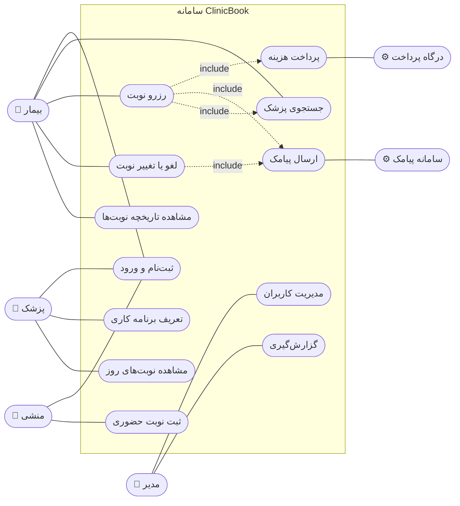
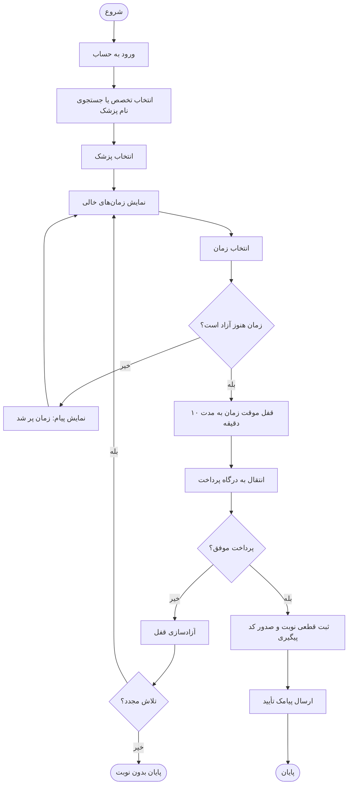
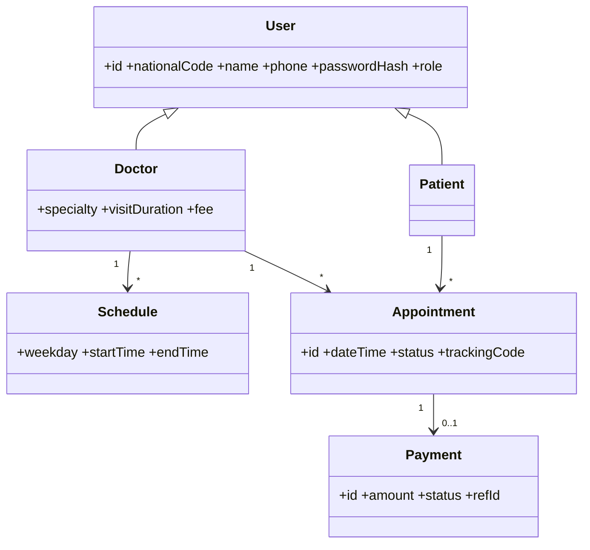

# هفته ۳ — مدل‌سازی نیازمندی‌ها (UML)

**موضوع جلسه:** فصل ۸ پرسمن

## ۱. نمودار Use Case

## ۲. شرح Use Case اصلی: رزرو نوبت

| بخش | شرح |
|---|---|
| شناسه | UC-03 |
| بازیگر اصلی | بیمار |
| بازیگران فرعی | درگاه پرداخت، سامانه پیامک |
| پیش‌شرط | بیمار وارد حساب خود شده و پزشک حداقل یک زمان خالی دارد. |
| پس‌شرط (موفق) | نوبت قطعی ثبت، زمان برای دیگران بسته و پیامک تأیید ارسال شده است. |
| پس‌شرط (ناموفق) | زمان انتخاب‌شده آزاد و هیچ نوبتی ثبت نشده است. |

**جریان اصلی:**
1. بیمار پزشک را جستجو و انتخاب می‌کند.
2. سیستم زمان‌های خالی پزشک را نمایش می‌دهد.
3. بیمار یک زمان را انتخاب می‌کند.
4. سیستم زمان را به‌مدت ۱۰ دقیقه برای بیمار قفل موقت می‌کند.
5. سیستم صفحه‌ی پرداخت را نمایش می‌دهد.
6. بیمار پرداخت را انجام می‌دهد.
7. سیستم نوبت را قطعی و کد پیگیری صادر می‌کند.
8. سیستم پیامک تأیید ارسال می‌کند.

**جریان‌های جایگزین:**
- **۳a:** زمان در همین لحظه توسط بیمار دیگری رزرو شده؛ سیستم پیام مناسب نشان می‌دهد و به مرحله‌ی ۲ برمی‌گردد.
- **۶a:** پرداخت ناموفق است؛ سیستم قفل را آزاد می‌کند و امکان تلاش مجدد می‌دهد.
- **۶b:** مهلت ۱۰ دقیقه تمام می‌شود؛ قفل خودکار آزاد و بیمار مطلع می‌شود.
- **۸a:** ارسال پیامک شکست می‌خورد؛ نوبت معتبر می‌ماند و ارسال در صف تلاش مجدد قرار می‌گیرد.

## ۳. Activity Diagram: فرایند رزرو نوبت

## ۴. نمودار کلاس مفهومی (تکمیلی)

