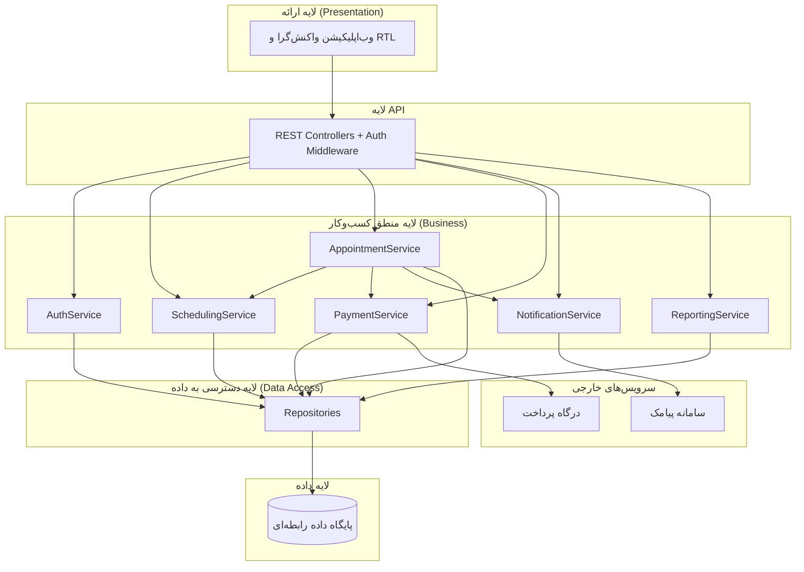

# هفته ۵ — معماری لایه‌ای و اینترفیس کامپوننت‌ها

**موضوع جلسه:** فصل‌های ۱۰ و ۱۱ پرسمن

## ۱. سبک معماری
معماری **لایه‌ای (Layered)** با ارتباط از بالا به پایین. هر لایه فقط به لایه‌ی زیرین خود وابسته است.



## ۲. دلایل انتخاب
- سادگی و آشنایی تیم با الگو
- تفکیک روشن مسئولیت‌ها و سهولت تست هر لایه
- امکان تعویض درگاه پرداخت و سرویس پیامک بدون تغییر منطق اصلی

## ۳. فناوری پیشنهادی
| لایه | فناوری |
|---|---|
| ارائه | React + Tailwind (RTL) |
| API و منطق | Node.js (NestJS) یا Spring Boot |
| داده | PostgreSQL |
| Cache و قفل موقت | Redis (TTL برای قفل ۱۰ دقیقه‌ای) |

## ۴. اینترفیس کامپوننت‌ها
```ts
interface IAuthService {
  register(dto: RegisterDto): User;
  login(nationalCode: string, password: string): Token;
  resetPassword(phone: string, otp: string, newPassword: string): void;
  hasPermission(userId: ID, permission: string): boolean;
}

interface ISchedulingService {
  setWeeklySchedule(doctorId: ID, schedule: WeeklySchedule): void;
  getAvailableSlots(doctorId: ID, from: Date, to: Date): Slot[];
}

interface IAppointmentService {
  lockSlot(patientId: ID, doctorId: ID, slot: Slot): LockToken;   // 10 دقیقه
  confirm(lockToken: LockToken, paymentRef: string): Appointment;
  cancel(appointmentId: ID, requesterId: ID): void;               // حداقل 2 ساعت قبل
  listByPatient(patientId: ID): Appointment[];
}

interface IPaymentService {
  startPayment(amount: number, appointmentRef: string): PaymentUrl;
  verify(refId: string): PaymentResult;
  refund(refId: string): PaymentResult;
}

interface INotificationService {
  send(phone: string, template: string, params: object): void;
  scheduleReminder(appointmentId: ID, at: Date): void;
}

interface IReportingService {
  appointmentsReport(from: Date, to: Date): Report;
  revenueReport(from: Date, to: Date): Report;
}
```

## ۵. ملاحظات کیفی معماری
- **همزمانی:** جلوگیری از رزرو تکراری با قفل توزیع‌شده در Redis و قید یکتا در پایگاه داده (`UNIQUE(doctor_id, slot_start)`).
- **امنیت:** احراز هویت با JWT، کنترل دسترسی مبتنی بر نقش در لایه‌ی API.
- **مقیاس‌پذیری:** لایه‌های API و منطق بدون حالت (Stateless) و قابل تکثیر افقی.
