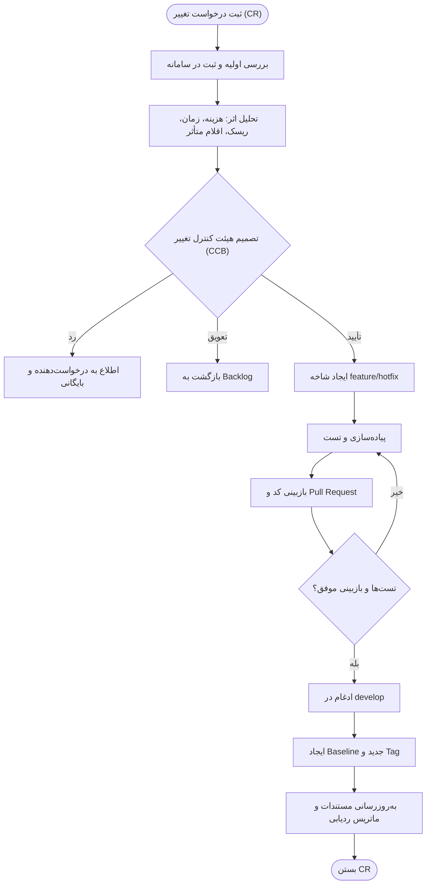

# هفته ۹ — مدیریت پیکربندی و کنترل تغییرات (SCM)

**موضوع جلسه:** فصل ۲۲ پرسمن

## ۱. اقلام پیکربندی (SCI)
- مستندات: نیازمندی‌ها، نمودارها، برنامه‌ی تست
- کد منبع هر ماژول
- اسکریپت‌های پایگاه داده (Migration)
- فایل‌های پیکربندی محیط‌ها (بدون رمز)
- گزارش‌های تست و مستندات انتشار

## ۲. راهبرد شاخه‌بندی در Git
| شاخه | کاربرد |
|---|---|
| `main` | نسخه‌ی پایدار منتشرشده؛ هر انتشار با Tag |
| `develop` | یکپارچه‌سازی ویژگی‌ها |
| `feature/*` | توسعه‌ی هر داستان کاربر (مثلاً `feature/US-03-booking`) |
| `release/*` | آماده‌سازی انتشار |
| `hotfix/*` | رفع فوری اشکال در نسخه‌ی منتشرشده |

- **نسخه‌گذاری معنایی (SemVer):** `MAJOR.MINOR.PATCH` مانند `1.2.0`
- **قالب پیام کامیت:** `نوع(حوزه): توضیح` مانند `feat(appointment): add slot locking`
- **Baseline:** در پایان هر Sprint یک Tag ایجاد می‌شود (`v0.1.0`، `v0.2.0`، ...).

## ۳. گردش‌کار کنترل تغییر

## ۴. فرم درخواست تغییر (Change Request)

| فیلد | مقدار |
|---|---|
| شناسه | CR-___ |
| تاریخ ثبت | ____ |
| درخواست‌دهنده | ____ |
| عنوان تغییر | ____ |
| شرح تغییر | ____ |
| دلیل و توجیه | ____ |
| نوع | تصحیحی / انطباقی / بهبودی / پیشگیرانه |
| اقلام پیکربندی متأثر | ____ |
| تحلیل اثر (زمان / هزینه / ریسک) | ____ |
| اولویت | بحرانی / بالا / متوسط / پایین |
| تصمیم CCB | تأیید / رد / تعویق |
| مسئول اجرا | ____ |
| وضعیت | ثبت‌شده / در حال بررسی / تأییدشده / در حال اجرا / انجام‌شده / رد‌شده |

### نمونه‌ی تکمیل‌شده
| فیلد | مقدار |
|---|---|
| شناسه | CR-001 |
| تاریخ ثبت | ۱۴۰۵/۰۸/۲۰ |
| درخواست‌دهنده | مدیر درمانگاه |
| عنوان تغییر | افزودن پیامک یادآوری ۲ ساعت قبل از نوبت |
| شرح تغییر | علاوه بر یادآوری ۲۴ ساعت قبل، پیامک دومی ۲ ساعت قبل از نوبت ارسال شود. |
| دلیل و توجیه | کاهش نرخ غیبت بیماران در روز نوبت |
| نوع | بهبودی (Perfective) |
| اقلام پیکربندی متأثر | ماژول Notification، FR-12، کیس‌های TC مربوط به یادآوری |
| تحلیل اثر | ۳ Story Point؛ بدون ریسک معماری؛ افزایش جزئی هزینه‌ی پیامک |
| اولویت | متوسط |
| تصمیم CCB | تأیید برای Sprint بعدی |
| وضعیت | تأییدشده |

## ۵. نقش‌ها
- **CCB:** مدیر درمانگاه (Product Owner)، مسئول فنی و مسئول کیفیت
- **Configuration Manager:** کنترل Baselineها و Tagها
