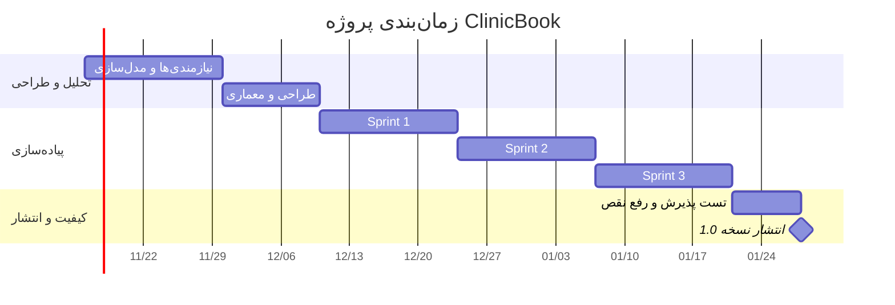

# هفته ۱۱ — تخمین، زمان‌بندی و نگهداری

**موضوع جلسه:** فصل‌های ۲۵ و ۲۷ پرسمن

## ۱. تخمین با Story Point (روش پوکر برنامه‌ریزی / فیبوناچی)
| شناسه | داستان | امتیاز | توجیه |
|---|---|---|---|
| US-01 | ثبت‌نام و ورود | ۳ | CRUD ساده + اعتبارسنجی |
| US-10 | مدیریت کاربران | ۳ | CRUD و تغییر وضعیت |
| US-05 | برنامه‌ی کاری پزشک | ۵ | قواعد زمان‌بندی و تولید اسلات |
| US-02 | جستجوی پزشک | ۳ | کوئری و فیلتر |
| US-03 | رزرو نوبت | ۸ | قفل موقت، همزمانی، یکپارچگی با پرداخت |
| US-04 | لغو یا تغییر نوبت | ۵ | قواعد زمانی و آزادسازی |
| US-07 | پیامک یادآوری | ۳ | زمان‌بندی و ادغام با سرویس پیامک |
| US-06 | پرداخت آنلاین | ۸ | ادغام خارجی و مدیریت خطا |
| US-08 | ثبت نوبت حضوری | ۵ | مشابه رزرو با قواعد منشی |
| US-09 | گزارش‌گیری | ۵ | کوئری‌های تجمیعی |
| | **جمع** | **۴۸** | |

**فرض‌ها:** سرعت تیم (Velocity) حدود ۱۶ امتیاز در هر Sprint دو هفته‌ای و هر Story Point معادل حدود ۴ ساعت کار.
**تخمین کل تلاش:** ۴۸ × ۴ ≈ **۱۹۲ نفرساعت** (به‌علاوه ۱۵٪ سربار تست و مستندات ≈ ۲۲۰ نفرساعت).

## ۲. برنامه‌ی Sprintها
| Sprint | داستان‌ها | مجموع امتیاز | هدف |
|---|---|---|---|
| ۱ | US-01، US-10، US-05، US-02 | ۱۴ | هسته‌ی کاربران و برنامه‌ی پزشک |
| ۲ | US-03، US-04، US-07 | ۱۶ | چرخه‌ی کامل رزرو و اطلاع‌رسانی |
| ۳ | US-06، US-08، US-09 | ۱۸ | پرداخت، منشی و گزارش‌ها |

### نمودار زمان‌بندی (Gantt)

## ۳. انواع نگهداری نرم‌افزار
| نوع | تعریف | مثال در ClinicBook |
|---|---|---|
| **تصحیحی (Corrective)** | رفع خطاهای کشف‌شده | رفع باگ نمایش اشتباه ساعت نوبت در منطقه‌ی زمانی |
| **انطباقی (Adaptive)** | سازگارسازی با تغییر محیط | تغییر API درگاه پرداخت یا ارائه‌دهنده‌ی پیامک |
| **بهبودی/کمال‌دهنده (Perfective)** | افزودن قابلیت یا بهبود کارایی | افزودن پیامک یادآوری ۲ ساعته (CR-001) |
| **پیشگیرانه (Preventive)** | بازسازی برای جلوگیری از مشکلات آینده | بازنویسی ماژول گزارش‌گیری برای کاهش پیچیدگی |

**پیش‌بینی سهم نگهداری:** بیشترین حجم نگهداری، از نوع بهبودی و انطباقی خواهد بود. برنامه‌ی نگهداری شامل پایش لاگ‌ها، به‌روزرسانی وابستگی‌ها هر ماه و بازبینی فصلی کد است.

## ۴. شاخص‌های پایش پروژه
- Burndown Chart هر Sprint
- سرعت واقعی در برابر پیش‌بینی
- تعداد نقص‌های باز و میانگین زمان رفع
